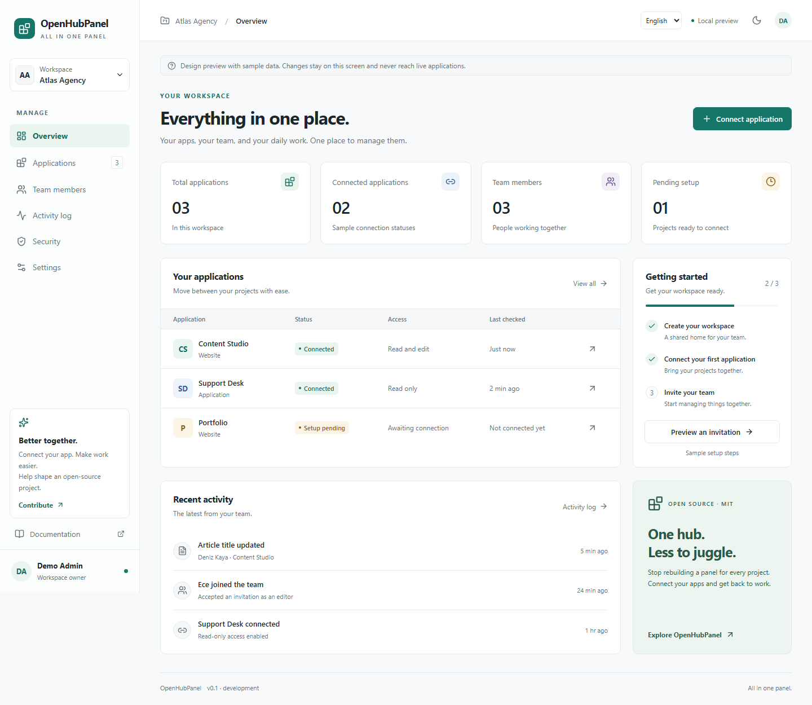

# OpenHubPanel

**All in one panel.**

Too many projects means too many admin panels. OpenHubPanel is being built to bring websites, applications, and the people who manage them into one place.

Use it as an application's admin panel, or as a hub for several. Connect a project, give your team the access they need, and get daily work done without rebuilding the same management screens each time.

This is early development. A separate [general workspace MVP](docs/deployment/general-workspaces.md) now provides PostgreSQL accounts, mandatory TOTP, workspaces, roles, invitations, applications and scoped API connections at `/workspace`. The [single-owner installation](docs/deployment/owner-installation.md) continues to support existing applications. The general MVP is developed on `feat/general-workspace-mvp`; it has not been deployed to that live installation. Read the [acceptance evidence and release limits](docs/research/general-workspace-mvp.md) before using real customer data.



## Try it locally

You need Git and Node.js 24. The preview needs no Docker, API keys, or cloud account. Repository access is currently restricted while development continues.

```sh
git clone https://github.com/gokhangozukara/OpenHubPanel.git
cd OpenHubPanel
npx --yes pnpm@12.18.0 install --frozen-lockfile
npx --yes pnpm@12.18.0 dev
```

Open http://127.0.0.1:3000/preview. It uses sample data, and changes stay in browser memory. The preview is disabled in production.

The interface supports **English, Turkish, and German**. Use the language selector to switch; your preference is remembered. Project files, code, comments, and documentation are written in English.

## General workspaces

Follow the [general setup guide](docs/deployment/general-workspaces.md) for a fresh independent installation with separate migration/application database roles and a one-use operator bootstrap command. Owners and invited users enroll an authenticator before management access. These screens use real APIs. Invitations are copyable links; no email delivery is claimed.

## Where it is headed

- Separate workspaces for clients and teams, with scoped memberships and application access.
- General sign-in with required authenticator codes, restricted recovery and revocable server sessions; the owner adapter retains its separate optional-MFA preference.
- A documented HTTP/JSON contract that developers can implement in their own applications.
- Shared lists, details, and forms for supported management tasks, with audit records.
- A responsive interface that works on a phone as well as a desktop.

An API integration will let you work inside OpenHubPanel using one local session. Opening another application's own panel without signing in again requires that application's SSO support; adding a link alone cannot provide it.

## What works now

The repository includes the general workspace MVP, a separate synthetic preview, three interface languages, PostgreSQL RLS, shared permission/connector contracts, a minimal worker and CI checks. The single-owner delivery adds native application registration/configuration, compatible-host push, independent empty storage, public configuration URLs and audited writes. General API integration supports article reads and separately approved title changes; its independent-HTTPS write trial and comprehensive UI-state MVP gate pass with local synthetic fixtures. See the [LOOP-2 evidence](docs/research/loop-2-release-gate.md).

Read the [project status](PROJECT_STATUS.md) for the boundary between working code and planned features. Start development with the [setup guide](docs/DEVELOPMENT.md). See the [vision](docs/product/vision.md), [roadmap](docs/roadmap/implementation.md), and [security design](docs/architecture/security.md) for the intended product.

For a new independent single-owner panel, follow the [standalone installation guide](docs/deployment/standalone-installation.md). The interface includes **Add application**, configuration URLs and **Connections** for API integrations and panel shortcuts. Setup starts with an empty application list and does not require an old panel. API integration currently supports article lists and separately approved title changes; arbitrary backend management remains outside that contract. General workspace setup uses the separate guide above.

## Contribute

Bug reports, code, documentation, accessibility fixes, and translations all help. Small improvements count. See [CONTRIBUTING.md](CONTRIBUTING.md), and use the [security policy](SECURITY.md) for private vulnerability reports.

OpenHubPanel's application code and visual design are written for this project. Local research copies of other panels are excluded from the repository and build context.

## License and contact

[MIT](LICENSE). You can use, modify, redistribute, and include OpenHubPanel in commercial work under the license terms. Contributions, stars, and sharing your changes are welcome, but voluntary. Contributors retain copyright in their own work; third-party notices must be preserved.

Created and maintained by [Gokhan Gozukara](https://github.com/gokhangozukara). Contact: [gokhangozukara@gmail.com](mailto:gokhangozukara@gmail.com).
